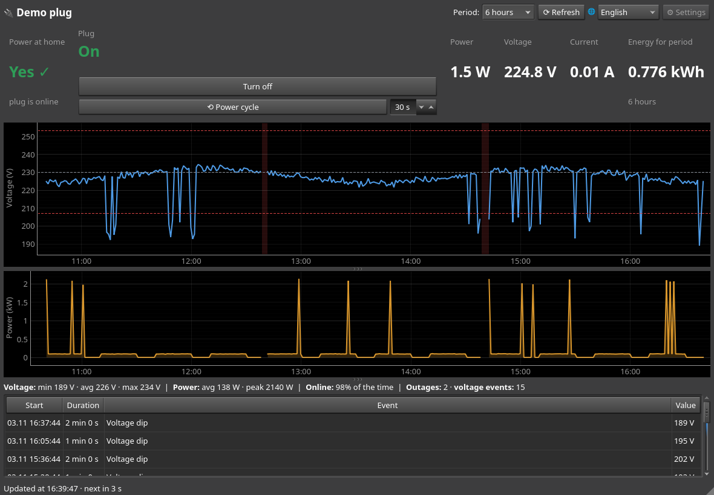

# SmartPlug: a monitor for Smart Life / Tuya plugs

**English** · [Українська](README.uk.md)

SmartPlug is a desktop app (Python + PyQt6) that shows the state of a smart plug from
anywhere in the world through the **Tuya Cloud API**.

- 🔌 **On / off** status, plus a button to switch the plug (it asks for confirmation).
- ⟲ **Power cycle**: turns the plug off for N seconds (set in the box next to the button,
  5–300 s) and back on. This lets a PC lose power completely and start again by itself.
  The BIOS needs *Restore on AC Power Loss → Power On*.
- ⚡ **Is there power at home?** If the plug drops off the network, there is most likely
  a power outage.
- 📊 Live **power (W), voltage (V) and current (A)**.
- 📈 **Voltage and power charts** for 1 h / 6 h / 24 h / 7 / 30 days. They show the
  normal range (230 V ± 10 %) and highlight outages.
- 🧾 **Event log**: outages, voltage dips and spikes, each with its duration and
  min / max value.
- 🔋 **Energy for the period** (kWh), integrated from the power readings.
- 🔔 **Desktop notifications** from the system tray. The app keeps running in the
  background.
- 🌐 **Interface language**: English (default) or Ukrainian. You can switch it on the
  fly from the toolbar (🌐), and the app remembers your choice.



> History is collected locally (SQLite) while the app is running, because Tuya Cloud
> only gives the current values for free.

## Installation

Requires Python 3.11+.

**Linux**

```bash
git clone https://github.com/Tern1277/smartplug.git && cd smartplug
python -m venv .venv
.venv/bin/pip install -e .
.venv/bin/smartplug --demo     # try it without keys (simulated plug)
.venv/bin/smartplug            # real plug
.venv/bin/smartplug --lang uk  # run in Ukrainian once
```

To add it to the application menu:

```bash
ln -s "$PWD/.venv/bin/smartplug" ~/.local/bin/smartplug
cp packaging/smartplug.desktop ~/.local/share/applications/
```

**Windows** (should work, but not tested yet)

```powershell
git clone https://github.com/Tern1277/smartplug.git; cd smartplug
python -m venv .venv
.venv\Scripts\pip install -e .
.venv\Scripts\smartplug --demo
```

## Getting the Tuya keys

1. Sign up at <https://iot.tuya.com> (free).
2. Go to **Cloud → Development → Create Cloud Project** and choose:
   - Industry: *Smart Home*;
   - Development Method: *Smart Home*;
   - Data Center: the one for your Smart Life account (**Central Europe** for Europe).
3. On the **Devices** tab, choose **Link App Account → Add App Account**. Scan the QR code
   with the Smart Life app (Me → scanner icon in the top right corner).
4. Copy the **Access ID** and **Access Secret** from the **Overview** tab.
5. In SmartPlug:
   - open **⚙ Settings** and paste the keys;
   - click **Connect and find devices**;
   - pick your plug and click **Save**.

The keys are stored only on your computer in `~/.config/smartplug/config.json`, which can
be read only by your user. Don't publish this file or paste the keys into chats.

> The free *IoT Core* subscription on Tuya expires after a while. You can extend it for
> free in the console (Cloud → Cloud Services). Each poll is one API request, so the
> default interval is 60 s.

## How it works

| Module | What it does |
|---|---|
| `cloud.py` | Tuya Cloud client (built on `tinytuya`) and `PlugService` |
| `devices.py` | Device models. Converts raw DPs (`cur_power`, `cur_voltage`, …) using the `scale` from the device specification |
| `analysis.py` | Event detection (offline, voltage out of range), energy, statistics |
| `storage.py` | Reading and event history in SQLite (`~/.local/share/smartplug/`) |
| `poller.py` | Background worker (QThread), so network requests don't block the UI |
| `gui/` | Main window (pyqtgraph), settings dialog, tray |
| `demo.py` | Simulated plug for the demo and the tests |
| `i18n.py` | Translations. Source strings are in English; Ukrainian ones are in the `UK` dictionary. A test checks that every string is translated |

The app uses these API calls:
- `GET /v1.0/devices/{id}` returns online state and status in one request;
- `GET /v1.0/iot-03/devices/{id}/specification` returns value scales;
- `POST …/commands` switches the plug on or off.

## Tests

```bash
.venv/bin/pip install -e ".[dev]"
.venv/bin/python -m pytest
```

## Roadmap

- [ ] Other Tuya devices (multi-outlet power strips, switches, sensors)
- [ ] Notifications via a Telegram bot
- [ ] CSV export of the history
- [ ] Autostart via a systemd user service
- [ ] Windows build (`.exe`)

## License

[MIT](LICENSE)
